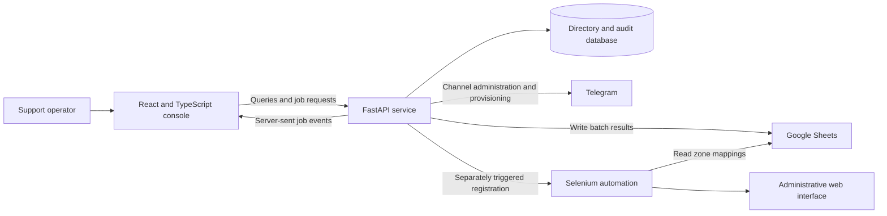

# Sapotoi

**An operations console for channel provisioning and browser-based registration**

## The operational problem

During my previous employment, routine support work meant looking up a premise, finding or provisioning its Telegram channel, and registering the channel in a separate administrative interface. The work crossed several tools, and a batch could take longer than the request that started it. I started Sapotoi as a personal initiative to give operators one place to do that work and see what happened. My colleagues and I used it, and it helped simplify repetitive tasks.

## What I built

I independently designed and built the React/TypeScript frontend, FastAPI backend, relational directory and audit model, integrations, and release configuration. The console brought together three parts of the workflow:

- **Find and manage:** Search a server–zone–premise directory, administer Telegram channels across accounts, and check recent activity.
- **Provision:** Preview a zone-to-channel mapping and launch a batch. The backend used Telethon for channel creation and wrote successful results to Google Sheets.
- **Register and follow progress:** Start a separate Selenium run that reads the worksheet and attempts to register channel IDs through a web interface. Server-sent events show per-item outcomes without tying job progress to the launch request.

## Architecture at a glance

**Purpose:** Show how an operator starts work in one console while the integrations stay behind the API.

**How to read it:** Provisioning writes the worksheet; a separately triggered browser job reads it. That handoff keeps channel creation separate from portal registration, while live events let the operator follow both.

## Documentation

- [Software engineering documentation](docs/index.md): requirements, traceability, UML, design models and verification.
- [Case study](docs/case-study.md): my contributions, decisions and AI-assisted development.
- [Screenshot placeholders](docs/screenshots.md) · [Standalone edition proposal](docs/portfolio-edition-plan.md)

## Project status

This repository is a sanitized case study, not a runnable copy. In the November 26, 2026 offline review, the frontend build, backend syntax, and synthetic Compose checks passed; the full TypeScript check failed, and no application workflows were rerun. The standalone demo is proposed and has not been implemented.
