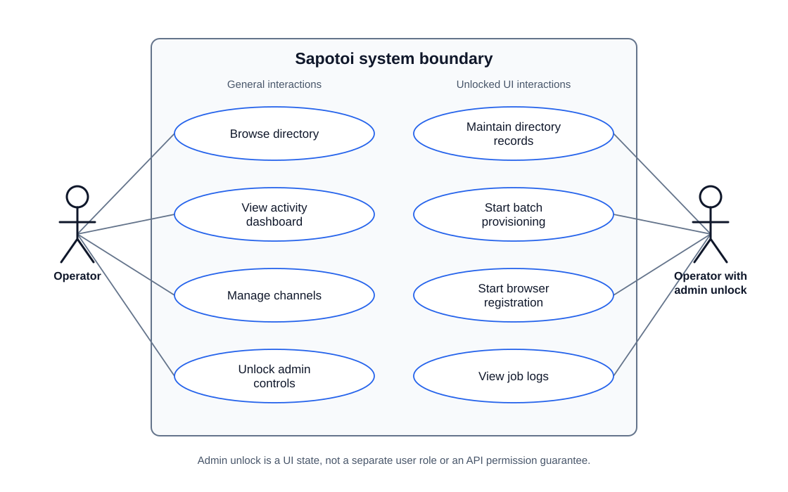
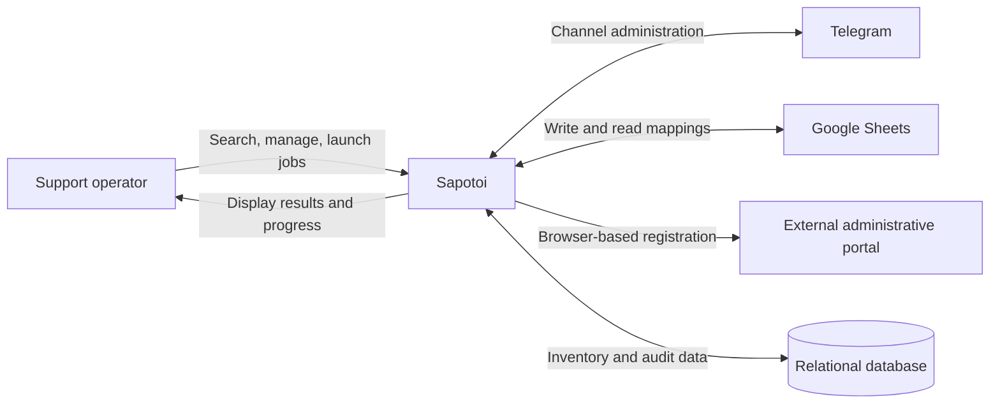
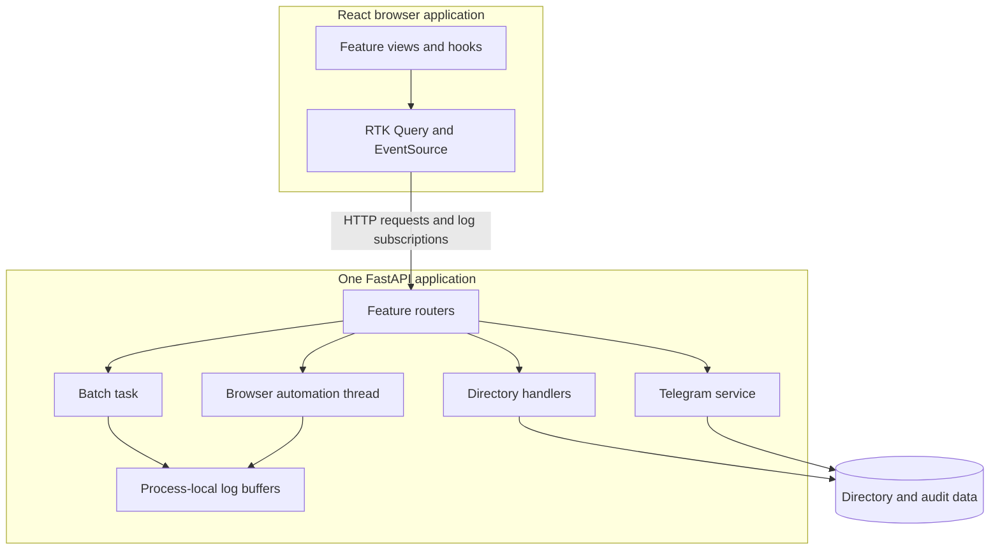
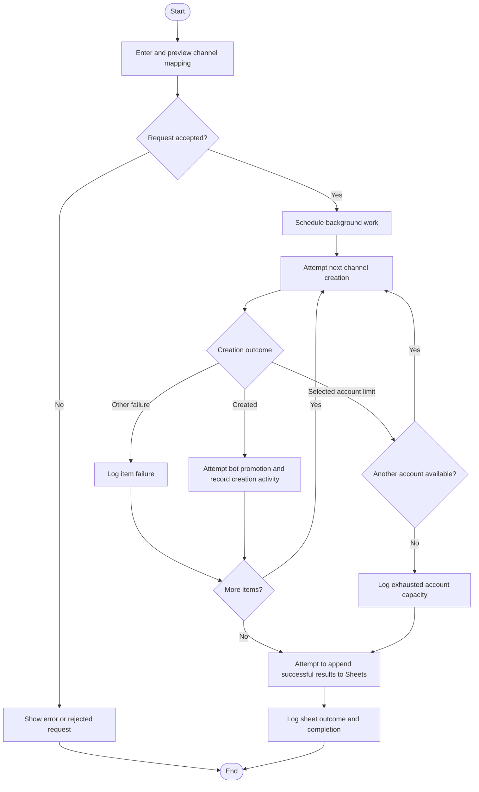
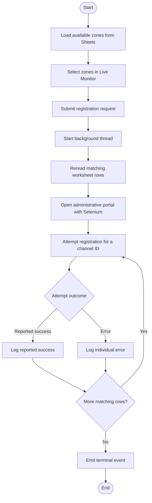
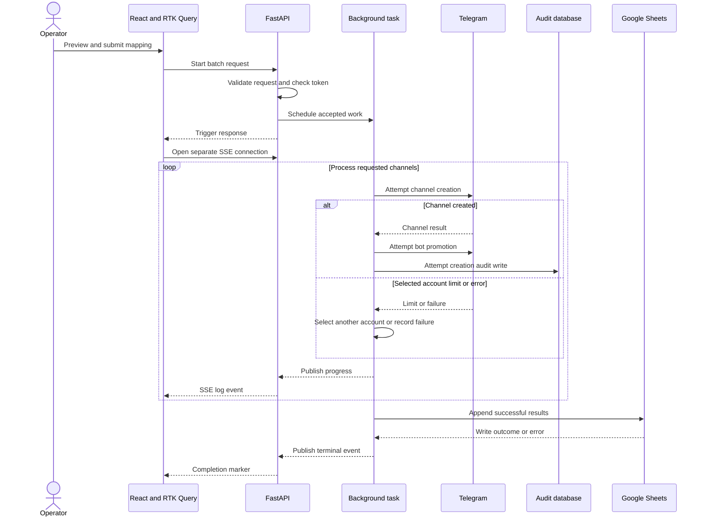
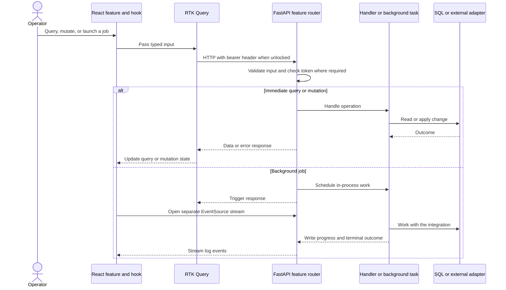
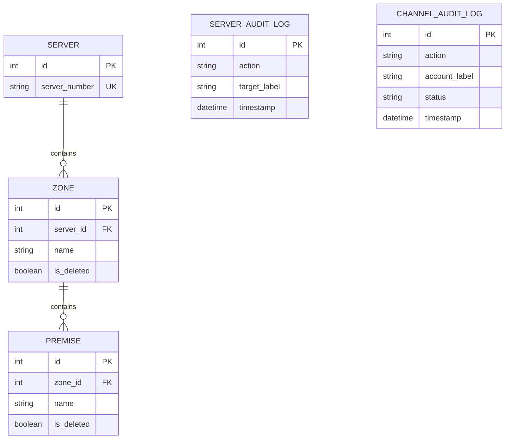
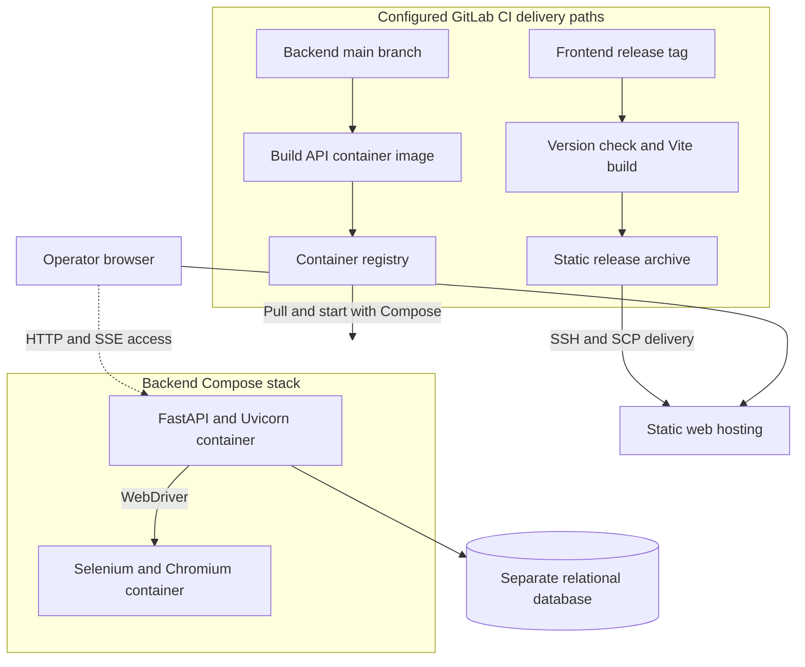

# Architecture and design models

[Documentation index](index.md) · [Requirements and traceability](requirements.md#requirements-traceability) · [Case study](case-study.md)

These figures integrate the supplied diagram pack and the existing API sequence. They describe the reviewed original implementation at different levels, not a live deployment or a complete permission model. The [proposed job lifecycle](portfolio-edition-plan.md#d10-proposed-durable-job-lifecycle) is kept with the standalone plan.

## 6. Actors and UML use case diagram

The primary actor is the support operator. The unlocked actor in the drawing is the same operator after a shared administrator unlock, not a separate kind of authenticated user. Telegram, Google Sheets and the administrative portal are external systems, shown in the context diagram rather than as human roles.

### D01: Operator use cases

**Purpose:** Describe what the operator can do without exposing service paths or implementation details.

[Editable PlantUML source](diagrams/use-cases.puml)

**How to read it:** The system boundary encloses the use cases. The two groups distinguish general interactions from controls shown in the unlocked UI. Logging and other API routes may have different protection than the UI suggests.

**Engineering decision:** Model the unlock as UI context, not role-based access control. The SVG is the readable GitHub representation; the PlantUML file is editable source.

## 7. System context diagram

### D02: Sapotoi in context

**Purpose:** Show the people, systems and data stores around Sapotoi.

**How to read it:** The operator interacts with Sapotoi. The relational database stores its directory and audit records; Telegram holds channels, and Sheets carries mappings between jobs. The separate portal receives registration attempts.

**Engineering decision:** Combine the operator experience behind one application boundary while retaining the external systems as separate sources of data and effects. Sheets is a handoff, not an automatic trigger.

## 8. Software architecture and component diagram

The frontend is a React and TypeScript single-page application built with Vite. Feature hooks, Redux Toolkit and RTK Query coordinate local interaction state and HTTP data. Python/FastAPI exposes a modular backend, with SQLAlchemy for a MySQL-compatible relational store, Telethon for Telegram, a Sheets integration and Selenium for browser work.

### D03: Browser and backend components

**Purpose:** Show how the browser hands work to the feature-specific backend modules and where data and job events are kept.

**How to read it:** The frontend makes normal HTTP calls through RTK Query and opens job feeds with native EventSource. Directory, channel, batch and browser responsibilities are modules in one FastAPI process. The optional viewer displays a browser session separately from the SSE feed.

**Engineering decision:** Keep feature interaction logic near the frontend views and integration work on the server. The original did not enforce a uniform BLoC contract, and the in-process jobs and buffers are not independent services or durable workers.

## 9. Activity diagrams

### D04: Batch provisioning activity

**Purpose:** Describe one provisioning run, including account limits and partial outcomes.

**How to read it:** The API accepts a mapping and schedules work. Channel creation, bot promotion, audit attempts and the final Sheets write are separate effects. The rejected-request branch is a logical outcome, not proof that the original UI handles every rejection.

**Engineering decision:** Report outcomes per item and attempt fallback for selected account limits; avoid interpreting a successful channel creation or terminal log as atomic success across systems.

### D05: Browser registration activity

**Purpose:** Describe the separate operator-triggered workflow that uses worksheet rows to attempt registration.

**How to read it:** Live Monitor starts the job for selected zones. A background thread reads the sheet again, and Selenium attempts registration for each matching channel ID. The diagram omits some startup failures.

**Engineering decision:** Keep browser registration separate from provisioning so it requires its own operator action. A reported click or terminal event is not an independent check of persisted portal state.

## 10. Sequence diagrams

### D06: Batch provisioning sequence

**Purpose:** Show when the UI, API, batch task and integration services exchange messages after a batch is accepted.

**How to read it:** The API schedules work and returns a trigger response. The UI then opens an SSE connection; the worker attempts Telegram operations, audit writes and a final worksheet append. Progress can arrive while the run continues.

**Engineering decision:** Separate the launch request from one-way progress streaming. The original uses process-local state and does not establish resumable, job-scoped delivery.

### D07: Regular HTTP and job log streams

**Purpose:** Contrast immediate data operations with the request-plus-stream pattern for long-running jobs.

**How to read it:** The feature hook uses RTK Query for normal HTTP. Job triggers have a separate EventSource connection for logs. The API checks bearer tokens only where configured; the SSE connection is not depicted as an authenticated request.

**Engineering decision:** Keep immediate queries and mutations on standard HTTP rather than forcing all interactions through a stream. The distinction also makes the limits of the original authorization and job-state model visible.

## 11. Entity relationship diagram

### D08: Directory and audit model

**Purpose:** Show the logical directory hierarchy and where audit data belongs.

**How to read it:** A server can have zero or more zones, and a zone can have zero or more premises. Audit tables are shown without foreign-key relationships to the changed records. Physical field names are generalized and sensitive fields omitted.

**Engineering decision:** Keep inventory and audit data in the relational store while leaving channels with Telegram. Soft deletion affects the normal directory list; the diagram does not imply durable job records or consistent filtering in every lookup.

## 12. API and external service integration

The browser talks to FastAPI rather than calling the integration providers directly. The app uses JSON or form data for HTTP operations and SSE for progress. Selected actions have a short-lived bearer token check; some Telegram operations and job streams do not have the same check in the reviewed source. Actual network access was not tested.

| Interface | Role in the original application | Limit or verification boundary |
| --- | --- | --- |
| Directory and activity API | Read hierarchy and audit data and handle supported mutations against SQLAlchemy models. | Audit and data changes are not established as a single atomic operation in every path. |
| Telegram through Telethon | Manage channels and sessions; create channels and attempt bot changes during a batch. | An external effect can succeed independently of the application audit or sheet write. |
| Google Sheets | Write successful batch results and read zone/channel mappings for registration. | The worksheet is a data handoff; no automatic cross-job trigger is shown. |
| Selenium and the administrative portal | Attempt channel registration using the portal UI. | Selectors and reported save actions do not independently verify persisted state. |
| SSE and optional browser viewer | Stream app log events; separately display the browser session when configured. | A lost connection does not prove the job failed, and a completion event does not prove all actions succeeded. |

See [D02](#d02-sapotoi-in-context) for the integration boundary, [D06](#d06-batch-provisioning-sequence) for the batch timing, and [D07](#d07-regular-http-and-job-log-streams) for the API protocol split.

## 13. Deployment architecture

### D09: Configured release and runtime design

**Purpose:** Separate the frontend build and delivery path from the backend image and runtime layout.

**How to read it:** The frontend tag pipeline produces a static archive. The backend pipeline produces a container image; Compose describes FastAPI/Uvicorn and Chromium/Selenium. Static hosting and the relational database are separate from that Compose stack.

**Engineering decision:** Deliver the SPA as static files and keep the browser process outside the API container. The browser-to-API arrow is logical, not proof of public reachability, live routing, TLS configuration or availability.
