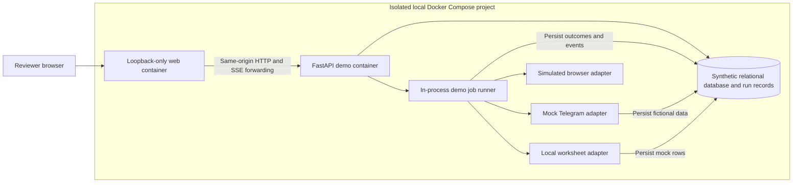
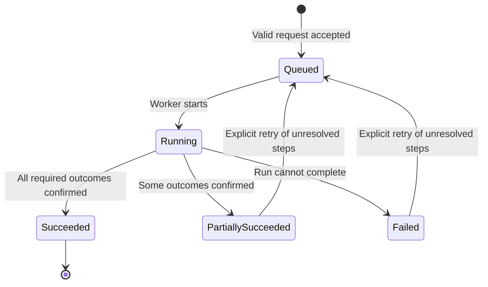

# Standalone Sapotoi portfolio edition proposal

[Portfolio home](../README.md) · [Case study](case-study.md) · [Original architecture](architecture.md)

**Status: proposed only.** There is no demo application, runnable Compose configuration or automated suite in this repository. I would write fresh code for the demo rather than copy the original application, its records or its integration configuration.

## What I want the demo to prove

A reviewer should be able to open the UI, browse a fictional directory, manage a simulated channel, provision a batch, and then run a separate simulated registration using the resulting worksheet rows. I want the reviewer to see where a run succeeded, where it did not, and what happens when they retry. Screens and exports would label all operational data and integration results as simulated.

| Component | Proposed behavior |
| --- | --- |
| Synthetic database | Use a local relational database with deterministic, obviously fictional servers, zones, premises, accounts and audit records. Add persistent job runs, item outcomes and event history for the demo. Apply explicit migrations and use a seed step that can be run twice without duplicating records. |
| Mock Telegram | Implement a local adapter that lists fixture accounts and channels, creates or renames synthetic channels, and changes fictional bot membership. Include deterministic duplicate, rate-limit and partial-failure scenarios. No Telethon sessions, Telegram accounts or live requests. |
| Mock Google Sheets | Use a local worksheet adapter that appends successful provisioning records, makes those rows available to the separately started registration job, and can simulate an append failure. Persist and deduplicate rows by synthetic operation key. No service-account key or Google SDK needed. |
| Simulated browser automation | Advance a deterministic sequence of states such as input loaded, registration attempted and confirmation received. Render a simulated activity timeline, without WebDriver, a replay of the original portal, or a remote browser viewer. Include a safe missing-input or rejected-save scenario. |
| Demonstration sign-in | Offer clearly labeled local-only viewer and operator roles. Use a rebuildable set of fictional users or an explicit demo-session action, and generate signing material locally at startup if needed. Never reuse an operational password or issue a credential that has value outside this demo. Enforce authorization in the API on mutations and per-run streams. |
| Functional frontend | Build an accessible React/TypeScript UI with a thin shell, feature-local views and controller hooks, one RTK Query cache and separate transport adapters. Include directory search, channel actions, batch preview, a mock worksheet preview, a registration launch action, and a live run detail view. Use local assets and clear pending, empty, error and retry states. |

## Proposed design diagrams

### D11: Isolated demo topology

**Purpose:** Illustrate the proposed local deployment and the isolation of simulated integrations.

**How to read it:** The diagram separates the reviewer’s browser from the containers and shows the mock adapters behind the API.

**Engineering decision:** I would expose only the web entry point on loopback; API and database services would have no host-published ports. The running stack would not require Internet access or external credentials. Images and packages might need an initial pull or build, so I would verify the no-egress claim separately against already built images. The UI would make only same-origin requests; server runtime would use an isolated internal network, mock-only adapters and no fallback to a live service. I would test that boundary rather than assume Compose alone makes it true. Start, health check, stop and explicit fixture-reset instructions would be documented only after I had verified them. Reset would target only the demo database and would never silently delete volumes.

### D10: Proposed durable job lifecycle

**Purpose:** Make partial success and explicit retry visible in the proposed standalone edition.

**How to read it:** The proposed lifecycle separates confirmed success, partial success and failure. An explicit retry queues unresolved work rather than assuming the entire run should repeat.

**Engineering decision:** Persist run and item outcomes and reconcile earlier effects before retry. This state model is conceptual and has not been implemented or tested.

## Build order and acceptance criteria

| Slice | Acceptance evidence I would require |
| --- | --- |
| 1. Directory and sign-in | Boot a fresh isolated stack, sign in as viewer or operator, find a seeded premise, and show that an operator can make a change while a viewer cannot. Verify that the list and audit entry update together. |
| 2. Channel workspace and batch run | Use the mock Telegram interface through real demo API and UI. Submit a valid multi-item batch, observe live updates tied to its run ID, then confirm each outcome and the expected rows in the mock worksheet. Invalid input produces a field error without side effects. |
| 3. Registration and failure recovery | Start registration explicitly from persisted worksheet rows. Exercise a partial batch failure, failed worksheet append and simulated rejected save. Retrying the failed step must not create duplicate channels or rows; the UI must distinguish rejected, failed and unconfirmed outcomes. |
| 4. Reproducibility and delivery | Run typecheck, lint, build, unit/API/browser tests and a Compose smoke test on the same revision. Repeat with cached images and outbound access blocked. Verify readiness, restart behavior, optional fixture reset, keyboard navigation and a mobile viewport. Record exact commands and their observed results in the demo README. |

## Automated test plan

- Start each slice with a failing test of the user-visible behavior. Unit tests should cover nested mapping validation, partial-result aggregation, quota fallback, allowed state transitions and retry rules. Inject deterministic failure scenarios rather than relying on timers or live services.
- API integration tests should use a disposable seeded database and real HTTP handlers wired to the local adapters. Verify role enforcement, audit atomicity for directory writes, job ownership, per-run SSE isolation, ordered event IDs, stream resumption, and deduplication after a failed write or repeated request.
- Browser tests should drive the real frontend through directory search, sign-in, provisioning, visible progress, worksheet output and separately launched registration. Include a failure/retry scenario and check the resulting records rather than only the success message. Fail the browser suite on unexpected external requests.
- Keep the first version single-worker and small enough to understand in an interview. Durable run records and idempotent steps are in scope; a distributed queue, real messaging accounts, live service callbacks and copied portal behavior are not.

The first demo deliverable would be a small, repeatable walkthrough with real local frontend/backend interaction and simulated integrations. I would not call it ready until the tests and startup flow passed from a fresh clone with only synthetic data.
